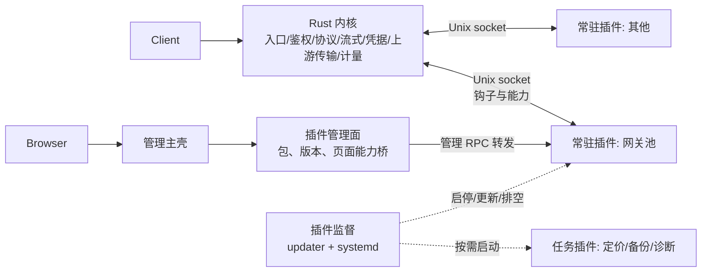

# 微内核插件架构

本文是把 proxy-for-self 改成“内核是薄壳、功能由插件提供”的设计，2026-10-13 确认，按第 11 节分期实施，每期单独验收。

## 1. 目标与非目标

目标：

- 内核只提供机制：入口、鉴权、协议、流式转发、提交边界、凭据、上游传输、计量计费、存储和插件运行时。
- 业务规则（调度、网关池、定时同步、统计口径等）放在插件里。插件改动不编译内核、不走网关 A/B、不重启网关。
- 插件禁用即停止进程并释放内存；插件崩溃只影响它负责的账号或功能。
- 每次请求经过插件的额外开销可度量、有上限，整体不慢于现状。

非目标：

- 不做恶意代码沙箱。插件是管理员安装的受信任代码；用独立进程、独立目录和 systemd 资源限制降低事故影响。
- 流式正文不经过插件。插件只在请求的几个决策点参与。
- 不支持多副本扩容；单活动内核加 A/B 发布保持不变。

## 2. 现状与问题

网关池功能分散在四处：Vue 界面、Python 控制面状态机（约 1200 行）、Rust 网关执行流程（约 2000 行）、插件策略函数（81 行）。只有界面和策略函数能热更新。2026-10-12、10-13 两个会话的实测：

| 会话 | 模型生成 | 工具执行 | 其中 Rust 检查/测试/构建 | 部署 |
| --- | --- | --- | --- | --- |
| 10-12 | 70 分钟 | 60 分钟 | 约 6 分钟（另有后台构建） | 约 10 分钟 |
| 10-13 | 121 分钟 | 118 分钟 | 约 20 分钟 | 约 8 分钟 |

主要耗时来自：一个功能跨四处修改与对齐接口、Rust 编译测试、控制面和网关各一次 A/B。控制面是 Python 内置多线程 HTTP 服务，每次调用新建连接和线程，32 个并发名额由管理页、插件页面和推理调度共用；每个网关池请求要调它 5～6 次。

## 3. 分层

| 层 | 职责 | 改动频率 |
| --- | --- | --- |
| 内核（Rust 网关） | 入口、Key 鉴权、协议转换、流式与提交边界、凭据保险箱、上游传输与账号出口、计量计费、PostgreSQL/Redis、默认调度、钩子分发与能力授权 | 低，走 A/B |
| 插件监督（updater + systemd 模板单元） | 安装校验、启动、自检、版本切换、排空、停止、崩溃重启 | 低 |
| 插件管理面（现 Python 控制面） | 插件包注册、版本与回滚、页面租约、页面能力桥；把插件自有管理接口转发给插件进程 | 低，不在推理路径上 |
| 插件 | 业务功能：界面、规则、状态、后台任务 | 高，热更新 |

两个网关槽连接同一组插件 socket。网关 A/B 切换不重启插件；插件更新不重启网关。

## 4. 插件形态与语言

| 形态 | 运行方式 | 平时内存 | 例子 |
| --- | --- | --- | --- |
| 界面 | 静态包，主壳加载 | 0 | 账号、密钥、分组、外观 |
| 常驻服务 | 长期进程，处理钩子和管理 RPC | 每个 3～10 MB（Rust）/ 15～20 MB（Python） | 网关池、以后的调度类插件 |
| 按需任务 | 有任务才启动，完成即退出 | 0 | 定价同步、备份计划、账号诊断 |

一个插件可同时包含界面和服务或任务。

语言：常驻服务默认用 Rust。原因是内存小、钩子延迟低、类型与内核协议共用。按需任务和低频逻辑可用 Python。插件只通过协议与内核交互，语言不影响内核。

Rust 插件放在独立 workspace `plugins/Cargo.toml`，共用 `kernel-protocol`（协议类型与帧编解码，位于 `backend/crates/kernel-protocol`，内核与插件共同依赖）和 `plugin-sdk`（位于 `plugins/sdk/plugin-sdk`：socket 服务、钩子接口、能力客户端、自检和排空、测试用模拟内核）两个 crate。插件与内核分开编译：改插件只增量编译插件 crate，依赖库首次编译后缓存。发布包包含 `x86_64-unknown-linux-gnu` 二进制及哈希，在本机 WSL 构建。

## 5. 通信协议

- 传输：每个常驻插件一个私有 Unix socket，由插件监听，目录权限只允许插件用户和网关组访问。内核主动连接并保持长连接；A/B 两个网关槽各自连接，插件同时服务多条连接。一条连接双向使用：内核调用钩子，插件在同一连接上调用内核能力，连接本身即插件身份。
- 编码：4 字节大端长度前缀 + UTF-8 JSON，单帧上限 1 MiB，超限即断开连接。消息分三种：`request`（带 `id`、`method`、`params`）、`response`（带对方请求的 `id` 与 `result` 或 `error{code,message}`）、`notify`（无 `id`，不回复）。两端各自编号，响应按自己发出的请求匹配。未知字段一律忽略，新增字段必须可选。
- 版本：`kernelApi` 为 `主版本.次版本`。P0、P1 期间为 0.x，合同可调整；P1 验收后冻结为 1.0，此后次版本只做向后兼容的新增。
- 握手：双方交换 `kernelApi` 版本范围、插件 ID 与内容版本、声明的钩子和能力。版本不兼容时内核拒绝连接，并按插件声明的禁用行为处理（第 8 节）。
- 身份：内核用 socket 对端凭据（`SO_PEERCRED` 的 uid）和插件 ID 确认身份，按清单授权能力，每次调用都检查。
- 超时：每个钩子有独立超时。超时或连接断开按“插件不可用”处理，不阻塞其他账号。
- 方向：内核 → 插件为钩子、管理 RPC、自检、排空；插件 → 内核为能力调用。

## 6. 钩子

第一期只做调度和请求结果相关的钩子。

### 6.1 账号归属

插件在设置里声明它负责的账号分组（网关池即现有“网关池分组”），握手时在 `hello` 结果的 `ownedGroups` 中报告，设置变化时发 `ownership.changed` 通知。一个分组同一时间只归一个插件；两个插件声明同一分组时，后声明者的该分组被拒绝并记入健康状态。请求的候选账号里没有插件负责的账号时，不调用任何插件，走内核默认调度。

内核把每个插件最近一次报告的归属写入运行目录的 `plugin-ownership.json`（两个网关槽共用）。插件已启用但未连接时（启动中、崩溃、重启），按缓存的归属让这些分组的账号失败关闭；插件在注册表中被禁用或移除时，删除缓存的归属，账号交还默认调度。

插件还可以声明观察分组 `watchedGroups`（协议 0.3）：这些分组的账号仍由内核默认调度，但内核在收到它们的上游响应头后调用 `response.observe`，插件可要求换一个账号重发（用于动态分组的降智检测）。观察分组与归属分组一起报告和缓存；同一分组可以被多个插件观察，但不能同时被另一个插件拥有。

### 6.1.1 注册表与授权

内核从 root 管理的插件注册表（JSON 文件，路径由内核配置给出，变化后自动重新加载）读取常驻插件：`id`、`enabled`、`socket`、`uid`（可选，给出时内核用 socket 对端凭据校验插件进程用户）、`grants`（允许的能力）、`fetchHosts`（`http.fetch` 允许访问的主机）。插件在握手中申请的能力与 `grants` 取交集。注册表由插件监督（updater）在安装、启用、禁用、卸载时写入。

能力只作用于插件归属或观察分组内的账号：`accounts.read`、`quota.read`、`upstream.probe` 只能用这些账号；`groups.move` 只能在这些分组之间移动这些账号。

### 6.1.2 内核侧位置

- `kernel-protocol`：叶子 crate，不依赖其他 workspace crate。
- `gateway-core::plugin`：与 Provider 无关的钩子与能力端口。
- `gateway-host` 的插件运行时：注册表加载、连接与重连、握手、归属表、钩子调用、能力分发与授权检查。
- Provider 在调度和响应头处调用 `gateway-core` 的钩子端口；`upstream.probe` 等能力由 Provider 和 Store 实现端口，在组合根注入。

### 6.2 请求路径上的钩子

| 钩子 | 时机 | 插件返回 |
| --- | --- | --- |
| `route.select` | 冻结快照、编译候选后、调度器选择前，候选中有本插件负责的账号 | 这些账号的优先顺序、持有窗口的账号、不可用账号及原因、原生续接的去留 |
| `route.prepare` | 调度器选中本插件的账号、发送前 | 租约 ID 与本次发送的附加材料（池 Cookie、turn state），或“等待/放弃”及原因码 |
| `response.head` | 收到上游响应头、尚未向客户端提交 | `accept`、`retry{delayMs}`（同网关重发）、`switch`（换网关重发）、`fail{code,message}` |
| `request.finish` | 请求结束（成功、失败、取消、中断） | 无；异步投递，不阻塞客户端 |
| `response.observe` | 观察分组账号收到上游响应头、尚未向客户端提交 | `accept`，或 `switchAccount`（内核排除该账号，按默认调度重选并重发） |

账号最终由内核调度器选定（并发、会话亲和、权重、请求间隔仍归内核），所以选择与准备分两步（协议 0.4）：`route.select` 在调度前给出本插件账号的优先顺序（可用在前）、持有窗口的账号、不可用账号及原因，以及原生续接固定账号时“留在原账号”还是“交给内核按安全规则恢复历史”；调度器选中本插件的账号后，再对该账号调用 `route.prepare`。插件账号的请求同步调用 3 次（选择、准备、响应头），结束通知异步发送；不涉及插件账号的请求不调用。

内核守住的边界不依赖插件：

- 已向客户端提交后，忽略 `retry`/`switch`/`switchAccount`。
- 请求不可安全重放时，不执行 `retry`/`switch`/`switchAccount`；原生续接、固定账号或诊断指定账号的请求不执行 `switchAccount`。
- 每个请求最多 4 次上游尝试，且受请求截止时间约束。
- `route.prepare` 返回 `fail` 时按“未发送、不可用”交给内核现有重试与换号规则，诊断带插件 ID 与原因码。
- 插件被禁用时，它负责的账号交还默认调度；插件运行中不可用（崩溃、超时）时，这些账号从候选中排除（失败关闭），其他账号照常调度；没有其他候选时返回带原因码的不可用错误。

### 6.3 管理 RPC

插件页面调用 `<插件ID>.*` 能力。插件管理面校验管理员身份和清单能力后，原样转发给插件进程的 `admin.call`，内核与管理面不再为每个插件写专用分支。

插件管理面直接连接插件 socket，握手时 `hello` 带 `role: "admin"`（协议 0.5；内核连接为 `role: "kernel"`，缺省按内核处理）。管理连接上只允许 `health` 与 `admin.call`；插件 SDK 不会把能力调用发到管理连接，也不在管理连接上转发钩子。

### 6.4 以后可加的钩子

- `request.observe`：请求事实的异步订阅，用于统计类插件。
- `account.changed`：账号或分组变更通知，代替插件轮询目录。

新钩子属于内核改动，按 `kernelApi` 小版本递增，旧插件不受影响。

## 7. 内核能力

按插件清单授权，在内核端逐次检查。

| 能力 | 内容 | 限制 |
| --- | --- | --- |
| `upstream.probe` | 用指定账号发一次只读响应头的探测请求，可带 turn state 和 Cookie；返回状态码、是否返回 state、新 state、Set-Cookie、限流头 | 只能用插件负责的账号；按账号限速；走账号出口；不返回 AT |
| `http.fetch` | 访问清单白名单内的外部地址（如池服务），可选直连或指定账号出口 | 只限白名单主机；响应大小上限 |
| `accounts.read` | 读取负责账号的状态、额度、分组、上游账号 ID | 只读，不含凭据 |
| `groups.move` | 在插件声明的分组之间移动账号 | 只限声明的分组，写审计 |
| `quota.read` | 读取账号额度快照与调度信号 | 只读 |
| 私有存储 | 插件数据目录，插件自管 SQLite | 目录 0700 |

插件可见：池 Cookie、turn state、池服务 Token（插件自己的配置）。插件永远不可见：AT、refresh token、Client Key 明文。

## 8. 生命周期

插件监督由现有 updater 扩展：它已经以 root 身份管理 Excel Worker 的安装、排空、替换和恢复。常驻插件运行在 systemd 模板单元 `proxy-for-self-plugin@<id>.service`，设置 `MemoryMax`、`Restart=on-failure`。网关不依赖插件单元。

| 操作 | 流程 |
| --- | --- |
| 安装 | 校验包哈希、二进制目标平台、`kernelApi` 兼容范围、能力声明；不通过则拒绝 |
| 启动 | 启动进程 → 插件完成数据库升级与配置加载 → 自检通过后才接受内核连接 |
| 热更新 | 新版本用新 socket 启动 → 自检通过 → 监督改写注册表中的 socket → 内核连接新 socket，新调用全部发往新版本，旧连接上未完成的调用继续完成后才关闭 → 监督向旧版本发 `drain`，等在途租约结束后停止旧进程。自检失败不切换，旧版本继续服务 |
| 回滚 | 保留上一版本二进制，按热更新流程切回 |
| 禁用 | 内核停止调用 → 排空 → 停止进程，内存释放。负责的账号交还内核默认调度，等同于没有安装该插件 |
| 崩溃 | systemd 退避重启；重启期间负责的账号暂时失败关闭并给出原因码，不交还默认调度（避免短暂故障时绕过插件规则） |
| 卸载 | 先禁用，再删除二进制；数据目录按管理员选择保留或删除 |

新旧版本可同时打开同一私有 SQLite（WAL）。表结构只增不删，保证回滚后旧版本仍能读取。租约存在数据库中，新版本可接管旧版本未结束的租约。

## 9. 性能与资源预算

| 指标 | 目标 |
| --- | --- |
| 单次钩子调用 p99 | ≤ 2 ms（本机 socket，不含插件内部的上游访问） |
| 插件账号请求的同步钩子调用 | ≤ 3 次（不涉及插件账号的请求为 0） |
| 常驻 Rust 插件内存 | ≤ 10 MB（`MemoryMax` 兜底） |
| 插件热更新耗时 | ≤ 2 分钟，网关不重启、不中断在途请求 |
| 插件禁用后 | 进程退出，内存释放 |

按 15 个插件、其中 4 个常驻估算：常驻 Rust 插件合计约 15～40 MB；按需任务平时为 0。

## 10. 开发与发布

- 目录：`plugins/<id>/plugin.json`、`ui/`、`service/`（Rust crate）或 `worker/`（Python）。
- 本地测试：`plugin-sdk` 提供模拟内核，插件测试不需要启动网关；契约测试覆盖协议和钩子语义。
- 集成验证：本机隔离测试环境（[plugin-stage.md](plugin-stage.md)）连接真实内核。
- 发布：构建插件包 → 插件管理安装 → 监督按热更新流程切换。只改插件时不构建内核、不走 A/B。
- 内核改动仍按 [A/B 发布](../deploy/ab-slots/README.md) 执行；目标是内核改动只在新增钩子或能力、上游协议变化时发生。

## 11. 分期计划

| 期 | 内容 | 发布 |
| --- | --- | --- |
| P0 内核运行时 | `kernel-protocol` 与 `plugin-sdk`；内核钩子分发、能力授权、`upstream.probe`、`http.fetch`；OpenAI Provider 在调度和响应头处接入钩子；updater 扩展为通用插件监督。旧网关池路径保留并用开关切换 | 网关 A/B 一次；updater 更新一次 |
| P1 网关池插件 | 用 Rust 实现网关池服务插件：控制面状态机、打票、降智确认、恢复检测、动态分组。先把现有 Python 与 Rust 测试改写为插件测试，再迁移逻辑；沿用现有私有 SQLite 数据。测试环境验收后上线，切换开关 | 插件安装；不发内核 |
| P2 清理 | 下一次内核发布删除旧网关池代码与控制面网关池模块 | 随下一次内核发布 |
| P3 首个纯插件功能 | 5xx 规则：同网关重试一次，仍失败则换网关 | 插件热更新 |
| P4 评估其他插件 | 定价、备份、诊断改为按需任务；Excel 并入统一监督；统计类插件视需要使用 `request.observe` | 逐个评估 |

每期在测试环境验收、用户确认后才上生产。P1 上线后旧路径保留一个版本周期，切换开关即可退回。

## 12. 代价与风险

- 内核协议成为长期合同，需要版本管理与兼容测试；首版设计必须稳。
- 网关池 Python 状态机改写成 Rust，存在行为偏差风险。缓解：先迁移测试，再迁移逻辑；测试环境用真实账号对比新旧路径的调度结果。
- 两个进程协作，排查问题要同时看内核和插件日志。统一请求 ID 贯穿两边。
- `upstream.probe` 会消耗账号额度。内核按账号限速，并只允许插件使用自己负责的账号。
- 内核仍需编译和 A/B；插件化减少的是内核改动的次数，不是单次内核编译的时间。
- P0 和 P1 工作量明显大于修一个 bug：P0 主要是新代码，P1 主要是迁移和测试。

## 13. 验收标准

- 只改网关池规则时，不编译内核、不走 A/B，热更新 2 分钟内完成，在途请求不中断。
- 网关 A/B 切换时插件进程不重启。
- 禁用网关池后插件进程退出；它负责的账号按普通账号调度，其他账号正常。
- 结束插件进程（模拟崩溃）时，只影响它负责的账号，systemd 自动拉起后恢复。
- 钩子 p99 延迟、插件内存、热更新耗时达到第 9 节指标；与现状对比单个请求的调度耗时。

## 14. 已确认的决定（2026-10-13）

1. 插件监督由 updater 承担，以 systemd 模板单元运行常驻插件。
2. 插件禁用时，它负责的账号交还默认调度，等同于没有该插件。这改变了现有“池开关关闭的账号不能降级直连”的约定，P1 实施时同步修订 [架构文档](architecture.md) 与 [网关池文档](gateway-pool.md)。
3. 网关池插件用 Rust 实现。

4. 插件管理面这一期保留 Python：只去掉网关池逻辑并改为通用转发，不改写为 Rust；以后是否并入内核另行评估。
5. 插件禁用时交还默认调度；插件运行中不可用（崩溃、重启、超时）时，它负责的账号暂时失败关闭。
